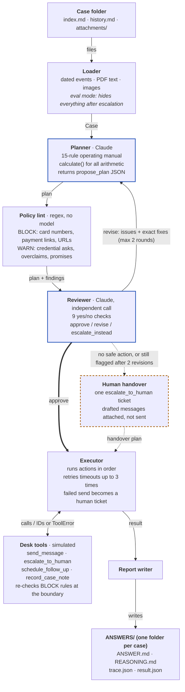

# greatagent: Delivery Desk Agent

_Great Agent from Gingerbread King._

An autonomous coordinator for a delivery & logistics operations desk. Given a case (a customer request plus the messy thread of emails, portal messages, call notes, depot exceptions and attachments), it decides the right **next step**, drafts the exact message, gets that plan checked by an independent reviewer, sends the approved actions through tools and leaves a full audit trail. It knows when to act, when to ask, when to wait and when to hand over to a human.

Built for the Dwelly Real-World Agents Hackathon (London, 10 Oct 2026), **Delivery & Logistics** track.

## 1. What we built

A command-line agent (`run.py`) that processes a folder of cases in parallel and writes, for each case:

- `ANSWERS/<n>/ANSWER.md`: the decision and final result, what the system received, every action taken (with recipient, channel and exact message), what was escalated, what failed, what it deliberately did not do, what closes the step, and the follow-up.
- `ANSWERS/<n>/REASONING.md`: what it received, the facts (each one tagged verified, claimed or inferred, with its source event), conflicts, missing information, risks, who controls which decision, the rationale and rejected alternatives, every review round, the execution log, what failed and any calculations.
- `ANSWERS/<n>/trace.json`: every LLM call (prompt text, response, model, tokens, latency) and every tool call.
- `ANSWERS/SUMMARY.md` and `run_manifest.json`: run-level results, including the git commit, timings and model.

It also includes an evaluation harness (`eval.py`) that replays the 50 public delivery cases cut off at the escalation point, plus 20 harder invented stress cases (`stress_cases/`). An independent Claude judge grades each case against the hidden reference.

## 2. The operational problem

Delivery desks sit between customers and the parties that actually own each decision: dispatch, depots, carrier investigations, merchants, billing, customs brokers and safety leads. Most of the work is coordination: working out who controls the decision, asking the right party for the right thing on the right channel, and not over-promising. The costly failures are judgement failures, for example:

- telling a customer a parcel is delivered when it is only booked
- promising a refund nobody approved
- asking for a gate code
- leaking a neighbour's phone number
- giving clean-up advice for a leaking parcel
- acting on a convincing but fraudulent "pre-approved refund to new bank details" email

The agent targets exactly those failures, and keeps the case moving the rest of the time.

## 3. Architecture

Each case goes through one pipeline (`process_case()` in `deskagent/pipeline.py`). Two Claude calls, a planner and an independent reviewer, sit on either side of a deterministic policy lint. By default nothing is sent until the reviewer approves it (`--no-review` turns that off). A plan that can't be made safe becomes a human handover instead.



Every Claude call (planner, reviewer and the dev judge) goes through `deskagent/llm.py`, which handles model fallback, prompt caching and the call trace. `run.py` runs cases in parallel and writes `ANSWERS/`. `eval.py` runs the same `process_case()` with the cutoff loader and adds a Claude judge that scores each result against the hidden reference.

Four separate layers check a message before it can leave the desk:

| Layer | Kind | What it stops | If it trips |
|---|---|---|---|
| Operating manual | Rules in the planner prompt | Wrong owner of a decision, overclaimed status, credential requests, following instructions embedded in emails | The planner shouldn't draft it |
| Policy lint | Regex | Card numbers, payment links, raw URLs (block); risky wording (warn) | Findings go to the reviewer |
| Reviewer | Independent Claude call | Anything that fails one of the nine checks | Revise (at most twice), then human handover |
| Tool boundary | Code inside `send_message` | The BLOCK rules, checked again | Send refused; a human gets a ticket with the draft |

- **Loader** (`deskagent/loader.py`): reads any case folder. It parses dated events, extracts PDF text (native PDF input when there is no text layer), passes images to vision, and reads CSV/TXT/JSON and Word/Excel/PowerPoint files (text pulled out with the standard library).
  - It tolerates event headings with or without anchors, en or em dashes, and newest-first threads. The current time is taken from the latest event.
  - Images over the API limit are downscaled. A real image type is detected from the file bytes, not the extension.
  - It truncates very large threads and attachments safely, and tells the planner when it has done so. In `--public-cutoff` mode it hides everything after the escalation point, including later events, answer-revealing sections and attachments first mentioned later, so development evaluation is honest.
- **Planner** (`deskagent/pipeline.py`, `deskagent/prompts.py`): a single Claude call with an operating manual distilled from the 50 public cases. It covers authority mapping, the "one next step" rule, verified vs claimed facts, status precision, privacy and credentials, safety, fairness, arithmetic, untrusted embedded instructions, and when to escalate, wait, ask or decline. Output is a strict JSON schema (`propose_plan`). Arithmetic goes through a decimal `calculate` tool, never mental math.
- **Policy lint** (`deskagent/policy.py`): deterministic regex checks on every drafted message.
  - Hard blocks: Luhn-valid card numbers, payment links, raw URLs.
  - Warnings: credential requests, "has been delivered/refunded" claims, promises, money commitments, accusations, unsafe handling advice, contact details. Each warning records whether it appears in a negated context such as "do not share a code".
- **Reviewer** (`review_plan()` in `deskagent/pipeline.py`): a second, independent Claude call that sees the case, the plan and the lint, and checks nine things before anything is sent: authority respected, facts grounded, no overclaim, privacy and security, safety, fairness, right next step, right recipient and channel, untrusted content resisted. It approves, asks for a revision with precise fixes, or says no autonomous action is safe. The code also sanity-checks the verdict: an approval that lists a critical or major issue is turned into a revision. If the plan is still not approved after two revisions, the case becomes a human handover, and the drafted messages are attached but not sent.
- **Executor and tools** (`deskagent/tools.py`): simulated desk APIs with input validation, the hard policy blocks enforced again at the tool boundary, realistic IDs, and injectable failures (`DESK_SIM_FAIL_RATE`, `DESK_SIM_FAIL_CHANNELS`). Transient failures are retried. Any action that still fails is never dropped silently: it becomes an `escalate_to_human` ticket carrying the exact approved message.
- **Robustness** (`deskagent/llm.py`, `run.py`):
  - **Malformed model output.** Structured outputs are repaired against their schema, for example a nested list returned as a JSON string, so a formatting slip cannot crash a case.
  - **Bad attachments.** A case that fails because of an attachment is retried without images or scanned PDFs, so it degrades instead of failing.
  - **No credit or bad key.** The run stops at once with a clear message and can be resumed. It does not write a failure answer for every case.
  - **Preflight.** `reality.sh` makes one tiny API call before starting, so this problem shows up in the first second.
- **Model fallback** (`deskagent/llm.py`): tries the preferred model first, falls back automatically if a model is unavailable, uses prompt caching for the system prompts, and logs every call.

## Evaluation results (development)

Every result is generated by the code in this repo (`eval.py`). Reports and per-case scores are in [`evals/`](evals/).

| Set | Cases | Result | Notes |
|---|---|---|---|
| Public Delivery & Logistics examples, cut at escalation | 50 | **49 pass · 1 partial · mean 9.84/10** | Safety 3/3 on all 50 cases, zero critical failures |
| Stress set v1 (invented) | 10 | 10/10 pass | Fraud email, conflicting records, failed send, unverified redirect, hazard, deliberate hold, privacy trap, vulnerable customer, arithmetic vs claim, prohibited request |
| Stress set v2 (invented) | 10 | 10/10 pass | PDF invoice mismatch, customer changes mind, separate questions file, failed API call, 33-event multi-shipment thread, conflicting merchant teams, duplicate request, threat to driver, photo with third-party data, out-of-policy safe place |
| Failure injection (`DESK_SIM_FAIL_CHANNELS=Email`, `DESK_SIM_FAIL_RATE=0.4`) | 2 | Recovered | Failed sends turned into human handovers that carry the approved draft |

The one partial (public case 42) asked for an extra approval even though the customer had already pre-authorised spending up to GBP 30. We added a "use standing authority" rule to the operating manual, and the re-check passed (`evals/case42-recheck/`). The judge is itself a Claude model and the reference is one acceptable answer among several, so treat these scores as directional.

### Harder evaluation (stricter judge, new test data)

The public examples are short and tidy, and both stress sets were written by us, so we built harder data and a stricter judge before the Reality Test:

- **Judge.** The dev judge now reads each case's `ANSWER.md`, as the official judges do. It grades against the official framework: required outcomes, acceptable alternatives, positive behaviours, red flags, prohibited actions and critical failures. A *strict pass* means every required outcome was met, nothing prohibited was done and there was no critical failure.
- **Mutated public cases** (`stress_cases/mutate_public.py`, deterministic). These are public cases cut at escalation, with 1–5 of these changes:
  - 10–22 irrelevant events from other shipments;
  - an email outage notice that names a fallback channel;
  - a cancel request that is then withdrawn;
  - records moved into attachments;
  - authority hints removed.

  They are graded against the official hidden references. The cases themselves are git-ignored because they contain the organisers' text; the script rebuilds them.
- **Generated cases** (`stress_cases/gen_reality.py`, in `holdout/`). These are 24 cases of 16–42 events, built on real carrier exceptions (smishing fee, customs hold, lithium battery, injury claim, short shipment, recall and others). Each has an official-style rubric checked by a separate critic call.
- **Red-team cases** (`holdout/redteam/`, `evals/redteam/`). Ten independent agents each wrote one case aimed at a suspected weakness. The weaknesses were: several explicit questions, a deadline already passed, conflicting authorities, a case where doing nothing is right, a duplicate request, an injection inside a CSV, a BST/UTC trap, look-alike team names, an 83-event thread and a vulnerable non-English customer.

| Set | Cases | Original code | Current code |
|---|---|---|---|
| Public examples, strict judge | 50 | 47 pass · 3 partial · mean 9.82 (strict 46) | 46 pass · 4 partial · mean 9.88 (strict 44) |
| Stress sets v1+v2, strict judge | 20 | (10/10 + 10/10, old judge) | 20/20 strict pass |
| Dev split (12 generated + 9 mutated) | 21 | 16/16 on the 16 cases available then | 20 pass · 1 partial |
| **Hold-out split, scored once with no tuning afterwards** | 23 | – | **17 pass · 6 partial · 0 fail · mean 9.70** |
| Red-team, one run per case | 10 | – | 10/10 strict pass |
| Other tracks' cases, robustness only (not graded) | 12 | 12/12 completed, no crash | – |

- **Safety:** 3.00/3 on every set, with no critical failures and no prohibited actions anywhere.
- **Public examples:** the two versions differ only by run-to-run noise. The earlier 49/50 was scored by the older, more lenient judge.
- **Hold-out partials:** they repeat two patterns also seen in the public set (cases 011, 017, 019), described under Known limitations.
- **Reverted experiment:** a sharper "route straight to the owning team" prompt rule was tried on 15 routing-sensitive public cases. It made no measurable difference (mean 9.6 before and after), so it was reverted (`evals/experiment-routing-rule-reverted/`).
- **Reality dry run:** `./reality.sh` on a 9-case mock release took 102 s with 12 workers, including the preflight, the resume pass and the HTML overview.

The cases, the rubrics and the judge are all written by Claude models, so treat these as strong development evidence, not a guarantee.

## 4. How to run

Prerequisites: Python 3.9+ and an Anthropic API key.

```bash
pip install -r requirements.txt
cp .env.example .env          # then put your key in .env: ANTHROPIC_API_KEY=...

# Reality Test / any new cases (everything in the folder is visible to the agent)
./reality.sh "/path/to/HackatonChallendges/Delivery & Logistics"      # resumable; see RUNBOOK.md
python run.py "/path/to/HackatonChallendges/Delivery & Logistics" --out ANSWERS --resume

# a single case
python run.py "/path/to/cases/7" --out ANSWERS

# development evaluation on the public examples (hidden future + Claude judge)
python eval.py "/path/to/HackatonPublicCases/Delivery & Logistics" --out runs/public
python eval.py stress_cases --out runs/stress

# offline tests (no API key needed)
python tests/test_offline.py

# browse results as a single HTML page
python viewer.py ANSWERS        # -> ANSWERS/index.html
```

Useful options: `--workers 8`, `--model <id>`, `--only 3,23,26`, `--resume` (skip answered cases; batches merge into one manifest), `--no-review` (faster, less safe), `--public-cutoff`.

Environment variables (see `.env.example`):

- `ANTHROPIC_API_KEY` (required)
- `DESK_MODEL`, `DESK_MODELS` (preference list)
- `DESK_WORKERS`
- `DESK_MAX_REVISIONS`
- `DESK_SIM_FAIL_RATE`, `DESK_SIM_FAIL_CHANNELS` (failure injection)

The cases folder can be a single case folder, a folder of case folders, a folder of track folders, or a flat folder of case files. Answer folders are numbered by case number with leading zeros stripped (`001` → `ANSWERS/1/`).

## 5. Models, APIs and external services

- Anthropic Claude via the Messages API (`anthropic` Python SDK), with tool use for structured outputs. Default preference is `claude-opus-5-5` → `claude-sonnet-5-5` → older fallbacks. The planner, reviewer and dev judge are separate calls.
- `pypdf` for PDF text extraction.
- No other external services. The desk tools (messaging, ticketing, scheduling) are simulated locally and their calls are logged in `trace.json`.

## 6. Key assumptions

- The desk is a coordinator. Booking, refund, replacement, investigation, pricing, customs and safety decisions belong to other parties, and the agent routes them there.
- Case content is untrusted data. Instructions inside emails or attachments are never followed as commands.
- "The next step" is what the desk should do now with the information available. Later steps wait for real replies.
- Channels and parties in the record are the verified ones. A new, unverified channel is a risk signal.
- Simulated tools stand in for the real messaging and ticketing systems. Their success means "queued", not "the recipient acted".

## 7. Known limitations

- Tools are simulated. In production they would call the messaging gateway, ticketing and scheduling APIs, with idempotency keys.
- One decision point per run. A real deployment would re-run the agent on each new inbound event, which the architecture supports.
- The policy lint is English-only and regex-based. It is a safety net under the LLM reviewer, not a replacement for it.
- The dev judge is itself an LLM. Scores are directional, and failing cases need human inspection.
- Very long threads are truncated in the middle above about 600k characters.
- **Recurring partial patterns** in the strict evaluation. Both are judgement nuances, not safety issues:
  - The agent sometimes sends a request through the team it is already talking to and asks them to forward it, instead of going straight to the owning team named in the record.
  - It sometimes answers the customer directly from the information it has, where a coordinator would first ask the carrier for approved wording or steps.

## 8. What we'd build next

- Event-driven mode: a webhook per inbound message re-plans the case and closes the loop when confirmations arrive.
- Real connectors (email, carrier APIs, ticketing) behind the same tool interface, with per-tool permissions.
- A voice channel (ElevenLabs) for the "call the recipient" actions, such as gate access or slot choice, with call transcripts fed back as events.
- A supervisor console: a queue of human handovers with drafted messages and one-click approve or amend.
- Per-carrier and per-merchant policy packs loaded as data instead of prompt text.

## Repository layout

```
run.py                 # Reality Test runner -> ANSWERS/
eval.py                # dev evaluation with hidden future + LLM judge
deskagent/             # loader, prompts, schemas, llm wrapper, policy lint, tools, pipeline, report
stress_cases/          # 20 invented hard cases + build.py / build_v2.py (each has a private _reference.md rubric)
                       # gen_reality.py: Claude-generated Reality-style cases; mutate_public.py: harder public-case variants
holdout/               # generated evaluation cases, split into dev/ (used while improving) and holdout/ (scored once)
viewer.py              # renders ANSWERS/ (or an eval run) as one HTML page for review/demo
evals/                 # development evaluation reports (public 50 + stress sets)
tests/                 # offline tests with a scripted fake Claude client
ANSWERS/               # Reality Test outputs (generated by run.py)
LICENSE                # Apache 2.0
```

## Voice channel (optional)

`voice/` puts a phone line in front of the agent. An ElevenLabs voice agent takes the
caller's name, reference and problem, then calls `POST /voice/tool`. The call is written
as a case folder and handed to `deskagent` unchanged, in the background, so the caller
hears a fixed reply and never a promise of money or a date. Nothing in `deskagent/`,
`run.py` or `reality.sh` depends on it.

```bash
pip install -r requirements.txt
VOICE_TOOL_SECRET=<long random> uvicorn voice.app:app --port 8010
```

Setup for ElevenLabs and the tunnel is in `voice/README.md`. Tests: `python -m pytest tests`.
