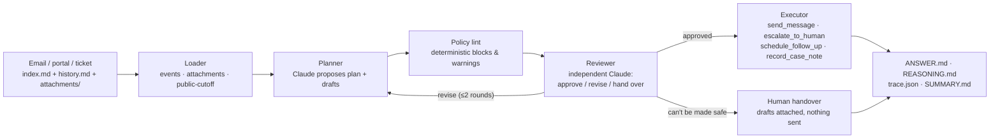
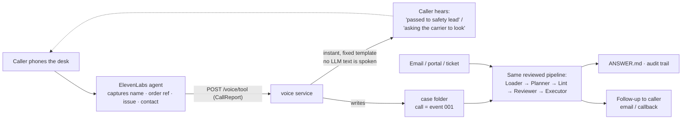

# kash.testing ↔ deskagent — how the lanes fit

Proposal for merging the `kash.testing/` lane (`feat/case-scorer`) with `deskagent` on
`main`. Nothing here changes `deskagent` — every integration point calls its public
functions (`load_case`, `process_case`) the same way `run.py` does.

## The flows

**Without voice — every channel today goes through the same reviewed pipeline:**



**With voice — the call becomes a case; two things happen from one webhook:**



The split is the whole point: the caller gets an **immediate, safe acknowledgement** off
a template; the *decision* is made by the same reviewed pipeline every other channel
uses — voice is an add-on intake, never a different decision path.

## What each lane has today

| Concern | `main` (`deskagent`) | `feat/case-scorer` (`kash.testing/`) |
|---|---|---|
| Agent | `deskagent/`: loader → planner → policy lint → independent reviewer → executor | `agent/`: facts extraction → deterministic `decide()` → outbox |
| Case loader + cutoff | `deskagent/loader.py` (`--public-cutoff`, attachments→vision) | `scorer/cases.py` (same format → `AgentInput`) |
| ANSWERS writer | `deskagent/report.py` (ANSWER/REASONING/trace/SUMMARY/manifest) | `agent/answers.py` + `outbox.py` |
| Evaluation | `eval.py` — LLM judge, 49/50 @ 9.84/10 on public-50 | `scorer/` — deterministic label-match, `raw_claude` baseline |
| Hard cases | `stress_cases/101–120` + `build*.py` (invented) | `scorer/hardset.py` (mutations of public cases) |
| Voice | — | `voice/` — ElevenLabs webhook, template-only `spoken()` replies |
| Submission path | `reality.sh`, `RUNBOOK.md`, `SUBMISSION.md` | — |

## Proposed moves

### 1. `voice/` → top-level `voice/` package (the headline merge)

The voice service becomes a channel *into* `deskagent`, not a second agent.

- `CallReport` (name, order ref, issue, contact) already renders as a case in the
  public format (`case_text()` writes the call as `event 001`). The adapter feeds it to
  `deskagent.loader.load_case` / `process_case` — either a temp case folder or a
  constructed `Case`.
- The decision maps back to speech through `spoken()`'s fixed templates. **No LLM text
  is ever spoken** — this is a safety property the lint can't give a voice channel, and
  it's worth keeping whichever way the decision is made.
- `setup_agent.py` provisions the ElevenLabs agent + webhook tool; ids (no secrets) in
  `voice/agent_ids.json`. Needs `APP_ELEVENLABS_API_KEY` + `VOICE_TOOL_SECRET`.

**Recommended: capture line.** Voice is one intake channel among several — its job is
to produce a well-formed `event 001`, then `deskagent` decides in the same reviewed
flow every other channel uses. `process_case` runs planner + reviewer (~2 Claude calls)
against a ~20 s ElevenLabs tool budget, so an inline decision would need `review=False` —
weaker safety on the one channel where a miss is spoken aloud. Capture-line has no
latency risk and keeps `spoken()` as pure templates.

The inline fast path (`process_case(review=False)` mid-call, probably 5–15 s) stays
documented but is not recommended; the better second demo, if time allows, is the
outbound leg — a case stuck awaiting info triggers a *call back* to the customer.

### 2. `scorer/` → independent second-opinion gate (keep in `kash.testing/` or move to `scoring/`)

`eval.py` is a nuanced LLM judge; `scorer` is a cheap deterministic check — *did the
agent's next action match the labelled one?* They're complementary. To score
`deskagent` we add one adapter in `scorer/agents.py`:

```python
def desk(case: AgentInput) -> dict:
    # AgentInput.text -> temp case folder -> load_case -> process_case -> map plan to Decision
```

Then `uv run python -m scorer.run --agent scorer.agents:desk` gives a second, judge-free
score on the same public cases — a cheap regression gate next to the full judge run.

### 3. `scorer/hardset.py` corpus → union with `stress_cases/`

Two generators, different methods: hardset mutates the 8 public bases (rewrites the
label for what a careful operator should do); `stress_cases/` invents new cases. Merge
the generated outputs into one corpus (`stress_cases/` or `evals/hard/`).

### 4. `agent/` → scorer baseline, not a second product agent

`kash.testing/agent/decide.py` becomes a second baseline next to `raw_claude` — the bar
"does deskagent beat the deterministic agent?" It already caught one real failure mode
(hyphen-insensitive refs, status-disagreement ≠ ref conflict) worth porting as a
`policy.py` lint rule or planner-prompt line on the deskagent side.

### 5. `scorer/cases.py`, `agent/answers.py`, `outbox.py` → retire in favour of `deskagent.loader` / `report.py`

Same job, less complete. Keep until (2) is wired, then delete.

## What this PR does *not* do

- Doesn't touch `deskagent/` source — all integration is additive.
- Doesn't pick the voice latency mode — needs a team decision (capture line vs inline).
- Doesn't commit any secrets. `VOICE_TOOL_SECRET` and the ElevenLabs key stay in env.

## Open questions for the team

1. Voice mode: capture-line only for 16:30, or inline decision if time allows?
2. Does the team want `scorer` as a pre-merge gate (fast, deterministic) alongside `eval.py`?
3. Where does the merged hard/stress corpus live — `stress_cases/` or a new `evals/` split?
4. Whose ElevenLabs account/number do we demo on?
