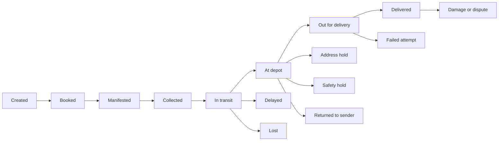

# Delivery case system model

This is a deliberately minimal model for understanding the Delivery & Logistics cases. It separates the operational records from the support cases raised around them.

## 1. Core objects

```mermaid
erDiagram
    ORDER ||--o{ SHIPMENT : contains
    SHIPMENT ||--o{ PARCEL : includes
    SHIPMENT ||--o{ EVENT : produces
    ORDER ||--o{ CASE : may_have
    SHIPMENT ||--o{ CASE : may_have
    CASE ||--o{ TASK : creates
    CASE ||--o{ EVIDENCE : contains
    ACTOR ||--o{ CASE : raises
    ACTOR ||--o{ EVENT : records

    ORDER {
        string order_id
        string merchant_id
        string customer_id
        string order_status
    }

    SHIPMENT {
        string shipment_id
        string order_id
        string carrier_id
        string shipment_status
        string destination
        datetime promised_at
    }

    PARCEL {
        string parcel_id
        string shipment_id
        string barcode
        string parcel_status
    }

    EVENT {
        string event_id
        string shipment_id
        string event_type
        string location
        datetime occurred_at
        string source_system
    }

    CASE {
        string case_id
        string case_type
        string raised_by
        string case_status
        string priority
        string owner
    }
```



- **Order**: what the customer bought.
- **Shipment**: one transport movement for part or all of an order.
- **Parcel**: the physical package, pallet, or carton.
- **Event**: an append-only observation such as a scan, handover, failed attempt, or warehouse receipt.
- **Case**: a request, dispute, exception, or investigation that needs work.
- **Task**: a concrete action created by a case, such as “confirm address” or “isolate parcel”.
- **Evidence**: a photo, document, temperature reading, proof of delivery, or other supporting record.

One order can have multiple shipments and parcels. For example:

```text
Order TG-020
├── DL-020-A: delivered
├── DL-020-B: delivered
└── DL-020-C: still at depot
```

## 2. Operational dashboard

The main dashboard could be a shipment-level table:

| Shipment | Order | Current milestone | Exception | Next action | Owner | ETA |
|---|---|---|---|---|---|---|
| DL-001 | TG-001 | Booked | None | Deliver | Carrier | 3 Feb |
| DL-002 | TG-002 | Depot hold | Missing apartment number | Confirm address | Support | — |
| DL-020-C | TG-020 | At depot | Missing from multi-parcel order | Trace and route | Depot | 22 Feb |
| DL-023 | TG-023 | Safety hold | Parcel leaking | Safety inspection | Depot safety | — |
| DL-039-O | TG-039 | Delivered | Duplicate shipment | Arrange return | Returns team | — |

Clicking a row should show:

1. The order and all related shipments/parcels.
2. Current status and exception.
3. Chronological event timeline.
4. Active cases and owners.
5. Documents, photos, and other evidence.
6. Next required action and deadline.
7. Audit history.

The displayed status should be a projection from events, not the only source of truth.

## 3. Shipment state machine



Some transitions are automatic; others require authority:

- `At depot → Out for delivery`: routing decision.
- `Failed attempt → Rebooked`: coordination task.
- `Delivered → Investigation`: case creation, not an immediate change to `Lost`.
- `Safety hold → Released`: authorized safety decision.
- `Returned → Reshipped`: merchant approval.

## 4. What a case adds

A case is a workflow layered over the operational records. It should not overwrite the raw event history.

```text
Shipment event or external message
              ↓
          Case created
              ↓
        Triage and ownership
              ↓
      Tasks / evidence / messages
              ↓
      Resolution or pending decision
              ↓
           Case closed
```

A case should capture:

| Field | Example |
|---|---|
| Raised by | Customer, merchant, carrier, depot, customs broker |
| Channel | Portal, phone, email, driver app, API |
| Linked object | Order, shipment, parcel, event |
| Request or claim | “Address is incomplete” |
| Requested action | “Add apartment number” |
| Case state | Open, waiting, investigating, resolved |
| Operational effect | Shipment hold, route block, refund review |
| Owner | Support, depot, safety, customs, billing |
| Evidence | Photo, scan, invoice, temperature log |
| Deadline | SLA or promised update |
| Resolution | Address corrected, replacement approved, claim pending |

## 5. Cases raised by different parties

### Customer

Example: missing apartment number.

```text
Customer portal message
    → support case
    → address correction task
    → shipment record updated
    → address hold cleared
```

### Carrier

Example: failed delivery or vehicle breakdown.

```text
Carrier operational event
    → exception case
    → customer notification
    → rebooking task
    → new delivery slot
```

### Depot

Example: leaking parcel.

```text
Depot observation
    → safety incident
    → hard shipment hold
    → isolation task
    → specialist assessment
```

### Merchant

Example: cancellation while a parcel is packed.

```text
Merchant cancellation
    → warehouse stop task
    → shipment removed from outbound cage
    → dispatch-stopped status
    → separate refund workflow
```

### Customs broker

Example: missing commercial invoice.

```text
Broker document request
    → customs case
    → clearance hold
    → shipper uploads invoice
    → broker validates document
    → clearance resumes
```

## 6. Easy-to-hard progression

### Level 1 — Simple status

One order, one shipment, one current state.

Example: a pre-arrival call request. The system only needs a shipment, delivery window, verified contact, and route note.

Main risk: promising an exact arrival time when only a callback request was recorded.

### Level 2 — Shipment data correction

Example: missing apartment number.

```text
shipment hold
→ customer correction
→ address validation
→ audit entry
→ hold release
```

Main risk: changing the wrong shipment or collecting unnecessary access information.

### Level 3 — Multi-parcel orders

The order-level status must be computed from individual parcel states. Two delivered parcels do not complete an order with three parcels.

Main risk: confusing order status with parcel status.

### Level 4 — Evidence and downstream decisions

Photos, invoices, labels, proof-of-delivery records, and temperature readings must be linked to the correct shipment and reviewed separately.

Receiving evidence does not automatically decide compensation, clearance, liability, or refund eligibility.

### Level 5 — Conflicting reports

Example: the carrier says “delivered” while the customer says “not received”. Preserve both facts:

```text
Carrier event: delivered at 08:10
Customer claim: parcel not received
```

Create an investigation case. Do not immediately change the shipment to `Lost`.

### Level 6 — Safety and regulatory holds

Leaking parcels, unsafe temperatures, customs holds, and hazardous handling require restricted permissions, specialist owners, and explicit release decisions.

Normal delivery routing must not bypass these holds.

### Level 7 — Reconciliation across related shipments

When an original and replacement both arrive, the system must reconcile multiple shipment IDs, authorize a duplicate return, record the physical collection, and avoid an extra charge.

## 7. Core principles

```text
Events describe what happened.
Statuses summarize the operational state.
Cases describe what someone is asking or disputing.
Tasks describe what must happen next.
Evidence supports a case.
Permissions determine who may change what.
```

The most important design decision is to keep these separate. A case may change an operational status, but the case itself is not the shipment status; a customer statement is not automatically a carrier event; and a booking, receipt, investigation, or approval is not the same thing as completed delivery.
